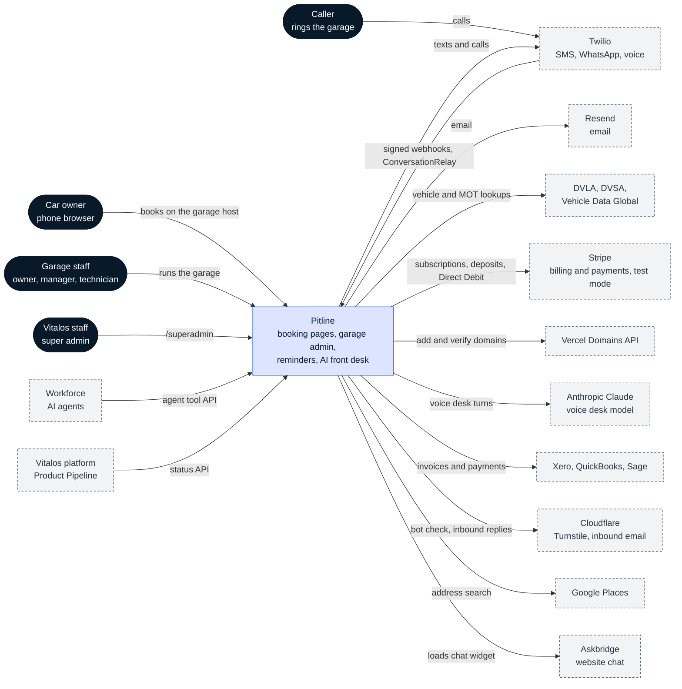
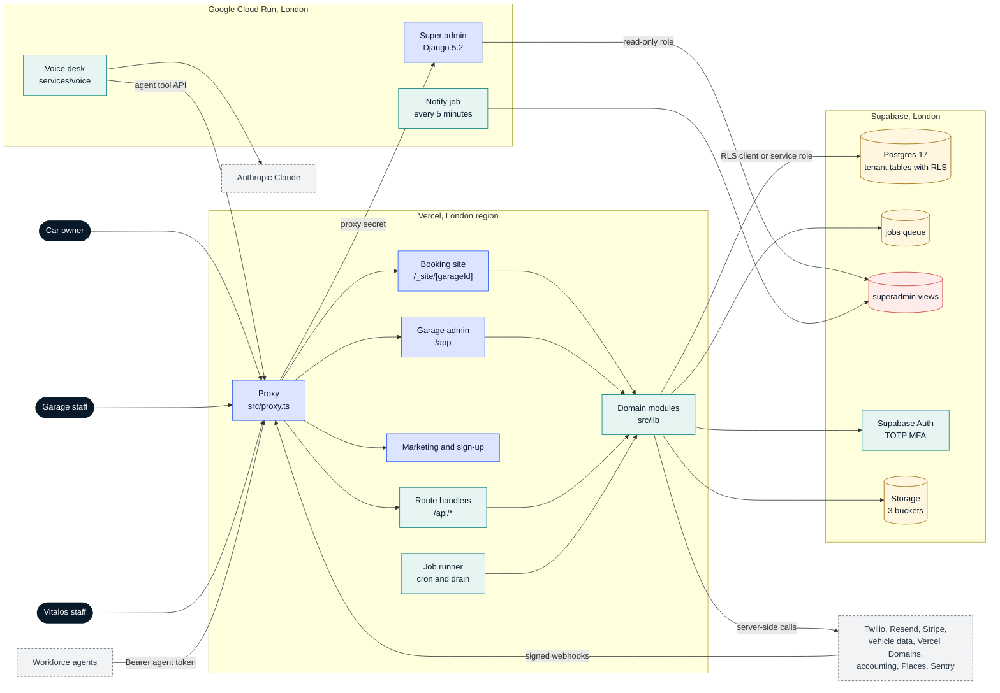

# System context and containers

Snapshot `82578f9`, 3 Nov 2026. Back to [README](README.md).

## System context (C4 level 1)

Car owners book on the garage's host, garage staff work at `pitline.co.uk`, and Vitalos staff use the super admin at `/superadmin`. Callers reach Pitline only through Twilio. Every outside service is called from server code; the browser only loads the Turnstile widget and, where a garage has switched it on, the Askbridge chat widget.

| Outside system | Used for | Where in the code |
| --- | --- | --- |
| Twilio | SMS and WhatsApp reminders and replies, missed-call handling, voicemail, ConversationRelay for the AI voice desk | `src/lib/messaging/`, `src/app/api/webhooks/twilio/`, `services/voice/` |
| Resend | Booking, invoice and enquiry email; delivery events | `src/lib/email/`, `src/app/api/webhooks/resend/` |
| DVLA VES, DVSA MOT History, Vehicle Data Global | Vehicle details and MOT expiry, cached by a peppered hash in `vehicle_facts` | `src/lib/vehicle/` |
| Stripe (test mode) | Garage subscriptions; deposits, pay-by-link and no-show fees through Connect; Direct Debit service plans | `src/lib/billing/`, `src/lib/payments/` |
| Vercel Domains API | Adding and verifying garages' own booking domains | `src/lib/vercel/`, job `domains.check` |
| Anthropic Claude | Model behind the AI voice desk (Haiku class) | `services/voice/src/llm.ts` |
| Xero, QuickBooks, Sage | Accounting sync (fake provider until developer apps exist) | `src/lib/accounting/` |
| Google Places | Address search at sign-up | `src/lib/places/` |
| Cloudflare | Turnstile bot check; signed inbound email for enquiry replies | `src/lib/turnstile.ts`, `src/app/api/webhooks/cloudflare-email/` |
| Sentry | Error tracking | `sentry.*.config.ts`, `src/instrumentation*.ts` |
| Askbridge | Each garage's own chat widget on its booking pages, by site key; Pitline sends Askbridge nothing | `src/components/askbridge/`, `src/lib/askbridge/` |
| Workforce | AI agents calling the agent tool API with a Pro garage's `workforce` token | `src/lib/agent-api/`, `docs/autofix/agent-api.yaml` |
| Vitalos platform | Product Pipeline reads the super admin's status endpoint | `superadmin/apps/autofix/` |

## Containers (C4 level 2)

| Container | Technology | Responsibility | Source |
| --- | --- | --- | --- |
| Proxy | Next.js 16 proxy (middleware) | Classifies the host (admin, free link, custom domain, unknown), rewrites garage hosts to `/_site/<garageId>`, sets per-garage CSP and `frame-ancestors`, forwards `/superadmin` with a shared secret | `src/proxy.ts`, `src/lib/tenancy/` |
| Booking site | Next.js App Router, server actions | Five-step booking flow, manage booking, reminder links, privacy and unsubscribe pages, Askbridge widget | `src/app/%5Fsite/[garageId]/` |
| Garage admin | Next.js App Router | Today, Diary, bookings, customers and cars, reminders, messages and calls, invoices, settings, Pro features | `src/app/app/` |
| Marketing site and sign-up | Next.js App Router | The only indexable page, contact form, garage sign-up and onboarding | `src/app/page.tsx`, `src/app/contact/`, `src/app/signup/` |
| Next.js super admin | Next.js App Router | Earlier platform console at `/admin` (garages, jobs, support sessions), kept until the Django one replaces it | `src/app/admin/`, `src/lib/platform/` |
| Route handlers | Next.js route handlers (56) | Public booking API, agent tool API, voice session exchange, webhooks, cron and drain, admin JSON | `src/app/api/` |
| Job runner | Node on Vercel functions | Claims jobs from the Postgres queue per kind with timeouts and backoff (16 kinds) | `src/lib/jobs/` |
| Domain modules | TypeScript | Booking engine, reminders, messaging, payments, plans, tenancy, consent; business rules stay out of routes and UI | `src/lib/` |
| Voice desk | Node 22, `ws`, Anthropic SDK | Answers missed calls for Pro garages over Twilio ConversationRelay and books through the agent tool API with a per-call token | `services/voice/` |
| Django super admin | Python 3.12, Django 5.2, HTMX, gunicorn | Vitalos staff console: garages, plans, jobs, messaging, domains, calls, enquiries, audit; read-only REST and status APIs | `superadmin/` |
| Notify job | Cloud Run job | Turns failures and new voicemails into staff notifications every 5 minutes | `superadmin/apps/notifications/` |
| Postgres 17 | Supabase, London | Tenant tables with RLS, booking and scheduling functions, the job queue, audit logs, `superadmin` views | `supabase/migrations/` |
| Supabase Auth | Supabase | Staff sign-in, mandatory TOTP for owners, AAL2 for platform admins | `src/lib/auth/`, `supabase/templates/` |
| Supabase Storage | Supabase | `public-media`, `health-check-media`, `enquiry-attachments` buckets | migrations `*_health_checks.sql`, baseline |
