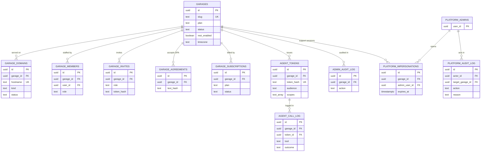
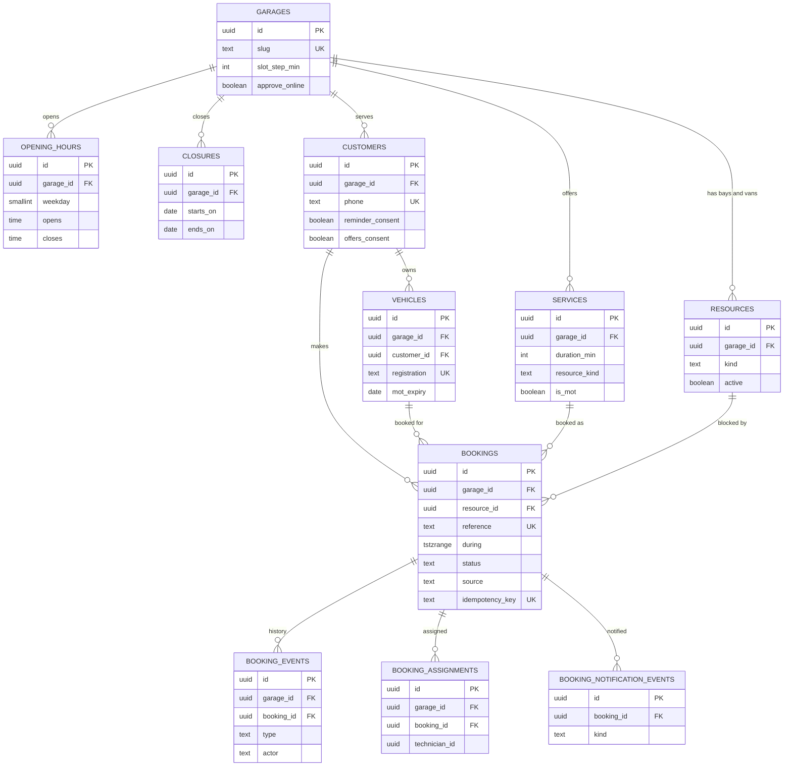
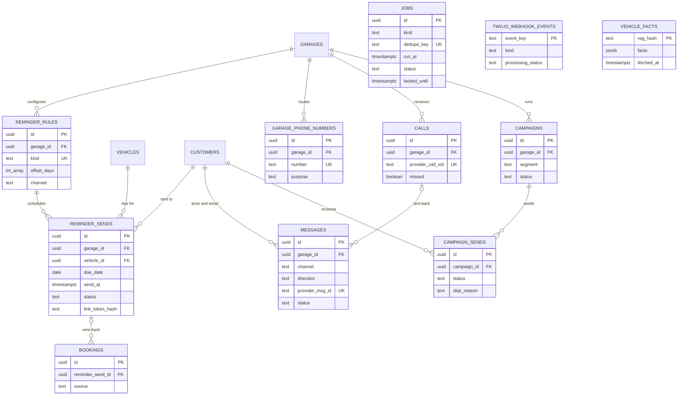
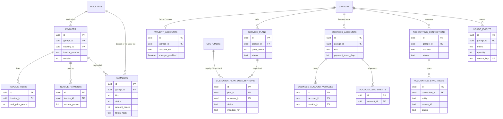
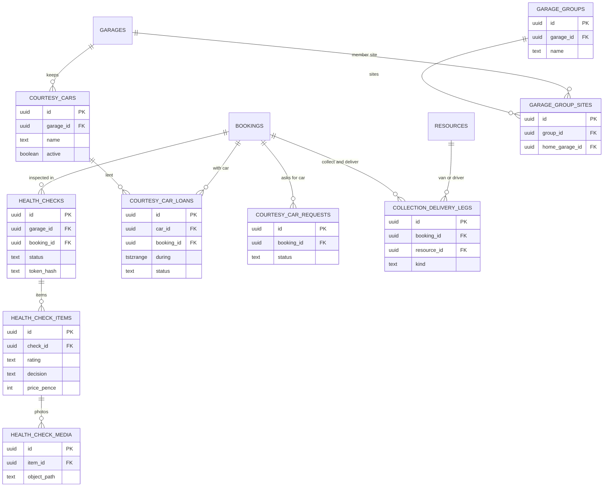

# Data model

Snapshot `82578f9`, 3 Nov 2026. Back to [README](README.md).

One Supabase Postgres 17 database in London holds every garage's data. The schema comes from 36 migrations in `supabase/migrations/` (SOB Autofix baseline, then tenancy, scheduling, reminders and the Phase 5 features). There are 93 tables in `public`, 20 masked views in the `superadmin` schema, and three Storage buckets. The diagrams show only primary keys, foreign keys, the tenant key and the most telling columns.

## Tenancy rules

- **Tenant key.** 75 of the 93 tables carry `garage_id uuid not null default public.current_garage_id()` with a foreign key to `garages` (`on delete cascade`) and an index that leads with `garage_id`. Child tables carry `garage_id` too and reference their parent through a composite key `(garage_id, parent_id)`, so a row can never point into another garage.
- **Row-level security.** RLS is on for every tenant table. Policies are `using (garage_id = (select public.current_garage_id()))`, with `with check` on writes and an owner check for owner-only actions. `anon` has no grants on tenant tables.
- **Where the garage comes from.** `current_garage_id()` returns the `x-garage-id` request header only for the service role or a member of that garage. The app sets the header from the request host (public pages) or from the signed-in member's selected garage (admin), never from a body or query string.
- **Platform tables.** The other 18 tables have no garage key: platform admins and their audit log, MFA and trusted-device tables, rate-limit buckets, webhook event ledgers (Twilio, Stripe, Resend, inbound email), platform enquiries and calls to Pitline's own line, and `vehicle_facts`. They are service-role only or narrowly granted.
- **Proof.** `tests/integration/tenancy.test.ts` enumerates every table with `garage_id` from `information_schema` and checks select, insert, update, delete and move for anon and for staff of two garages; a new table without a fixture fails the suite.

## Tenancy, access and audit

`garage_role()` returns the caller's role in a garage, or `owner` for a Vitalos support session (`platform_impersonations`) in read-only transactions only. Platform actions are written to the append-only `platform_audit_log` and to the garage's own `admin_audit_log`.

## Booking engine

- `bookings.during` is the time a resource is blocked (travel, duration, buffer). The constraint `no_overlap exclude using gist (resource_id with =, during with &&) where (status not in ('cancelled','no_show'))` is the last line of defence against double bookings.
- `create_booking(p_garage_id, p_booking)` (service role only) upserts the customer by phone and the vehicle by registration, picks the least-busy free resource under a per-garage advisory lock, inserts the booking and its first `booking_events` row, and replays the same booking for a repeated idempotency key.
- `available_slots()` builds candidate starts in the garage's time zone from opening hours, closures, notice and horizon, and returns how many resources are free at each.
- A trigger writes a `status_changed` event for every status change, naming the member or the system.

## Reminders, messaging and jobs

- `schedule_reminders()` creates idempotent `reminder_sends` rows only for customers with stored consent who have not opted out; MOT rows only while `garages.mot_enabled`.
- `claim_reminder_sends()` re-checks consent, opt-out, rule and due date at send time and records a `skip_reason` when a send should not go.
- `jobs` is the platform queue: `enqueue_job()` with a dedupe key, `claim_jobs()` with `for update skip locked` and a 5-minute lock, `fail_job()` with exponential backoff.
- `vehicle_facts` is keyed by an HMAC of the registration with a server-side pepper and holds no customer data; it expires after 30 days.
- `apply_message_retention()` clears message bodies, reminder bodies and voicemail links older than 12 months.

## Invoices, payments, plans and accounting

`payments` and `customer_plan_subscriptions` only ever reference Stripe objects by id (`checkout_ref`, `mandate_ref`, `subscription_ref`); card and bank details never reach Pitline. Accounting tokens are encrypted in `accounting_connection_secrets` with a server-side key. `usage_events` meter SMS and AI minutes per month with a unique `source_key` so retries count once.

## Pro operations

Health-check photos and videos live in the private `health-check-media` bucket and are served only through short-lived signed URLs; the customer opens the check through a link whose token is stored hashed. `courtesy_car_loans` and `collection_delivery_legs` have their own exclusion constraints on `during`, so a car, van or driver cannot be double-booked either.

## Super admin views

The `superadmin` schema exposes 20 views to the least-privilege role `autofix_superadmin` (migrations `20261028004000_superadmin_role.sql`, `20261029002200_superadmin_calls.sql`, `20261029003000_platform_enquiries.sql`). Phones, emails and registrations are masked in the database; message bodies, payloads and token hashes are left out. The role can call only four write functions (`platform_update_garage`, `platform_retry_job`, `platform_request_domains_check`, `platform_update_enquiry`), each of which re-checks the linked platform admin and writes the audit logs.

## Table inventory

| Domain | Tables | What they hold |
| --- | --- | --- |
| Tenancy and staff (8) | `garages`, `garage_domains`, `garage_members`, `garage_invites`, `garage_agreements`, `admin_profiles`, `site_settings`, `media_assets` | Garages, their hosts, members, invites, DPA acceptance and site settings |
| Security, admin and audit (9) | `admin_audit_log`, `admin_mfa_policy`, `admin_mfa_recovery_codes`, `admin_mfa_recovery_sessions`, `admin_trusted_devices`, `rate_limit_buckets`, `platform_admins`, `platform_impersonations`, `platform_audit_log` | MFA, trusted devices, rate limits, platform admins, support sessions and audit logs |
| Booking engine (14) | `resources`, `opening_hours`, `closures`, `services`, `service_prices`, `customers`, `vehicles`, `bookings`, `booking_events`, `booking_assignments`, `booking_audit_log`, `booking_notification_events`, `customer_imports`, `vehicle_facts` | Resources, hours, services, customers, vehicles, bookings and their history; imports and the vehicle facts cache |
| Reminders, messaging and calls (10) | `reminder_rules`, `reminder_sends`, `messages`, `calls`, `garage_phone_numbers`, `platform_calls`, `twilio_webhook_events`, `notification_attempts`, `campaigns`, `campaign_sends` | Reminder rules and sends, messages, calls, numbers, campaigns and the Twilio event ledger |
| Enquiries and email (8) | `enquiries`, `enquiry_attachments`, `enquiry_conversations`, `enquiry_messages`, `inbound_email_events`, `unmatched_inbound_emails`, `resend_webhook_events`, `platform_enquiries` | Customer enquiries and their email threads, inbound mail ledgers and contact-page enquiries |
| Invoices and payments (10) | `invoices`, `invoice_items`, `invoice_payments`, `invoice_number_sequences`, `invoice_email_sends`, `invoice_email_attempts`, `payments`, `payment_accounts`, `payment_settings`, `payment_webhook_events` | Invoices and their email, deposits, pay-by-link and no-show fees through Stripe Connect |
| Plans and billing (5) | `garage_subscriptions`, `plan_requests`, `usage_events`, `billing_usage_reports`, `billing_webhook_events` | Garage subscriptions, plan requests and metered usage |
| Pro operations (9) | `health_checks`, `health_check_items`, `health_check_media`, `courtesy_cars`, `courtesy_car_loans`, `courtesy_car_requests`, `collection_delivery_legs`, `garage_groups`, `garage_group_sites` | Digital health checks, courtesy cars, collection and delivery, multi-site groups |
| Fleet accounts and service plans (11) | `business_accounts`, `business_account_customers`, `business_account_vehicles`, `business_account_bookings`, `business_account_invoices`, `account_statements`, `service_plans`, `service_plan_inclusions`, `service_plan_uses`, `service_plan_invoice_applications`, `customer_plan_subscriptions` | Trade and fleet accounts with statements; customer service plans by Direct Debit |
| Accounting sync (3) | `accounting_connections`, `accounting_connection_secrets`, `accounting_sync_items` | Connections to Xero, QuickBooks and Sage, encrypted tokens and the sync ledger |
| AI front desk and agents (3) | `agent_tokens`, `agent_call_log`, `ai_front_desk_settings` | Agent tokens, the agent call log and per-garage AI desk settings |
| Platform jobs (1) | `jobs` | The background job queue |
| Carried over from SOB (2) | `offers`, `reviews` | Marketing content tables kept from the fork |

Dropped during the fork from SOB: `booking_service_types`, `service_catalogue_systems`, `provider_webhook_events` (Cal.com leftovers).
