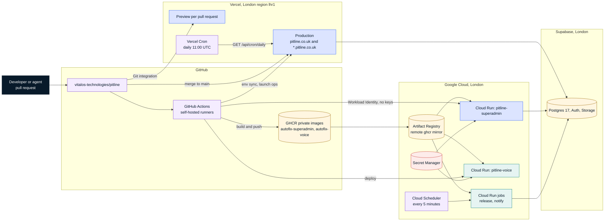
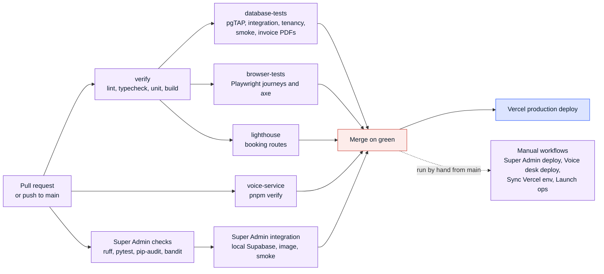

# Deployment and CI/CD

Snapshot `82578f9`, 3 Nov 2026. Back to [README](README.md).

## Runtime topology

Everything runs in or near London. The Next.js app is one Vercel project whose functions run in `lhr1`, next to Supabase in `eu-west-2`. The super admin and the voice desk are containers on Google Cloud Run in `europe-west2`; they moved there from Azure Container Apps on 1 Nov 2026 (DECISIONS D25). Images build to private GHCR packages and Cloud Run pulls them through an Artifact Registry remote repository.

| Part | Where it runs | Scaling and limits | How it is deployed |
| --- | --- | --- | --- |
| Next.js app (proxy, pages, route handlers, job runner) | Vercel project, functions in London | Serverless; Hobby plan today, so one daily cron | Vercel Git integration: preview per pull request, production on merge to `main` |
| Super admin | Cloud Run service `pitline-superadmin` | 0 to 1 instances, 1 vCPU, 512 MiB | Super Admin deploy workflow, run by hand; release job migrates its own tables first |
| Voice desk | Cloud Run service `pitline-voice` | 0 to 2 instances, 3600 s timeout for long WebSocket calls, session affinity | Voice desk deploy workflow, run by hand |
| Release and notify jobs | Cloud Run jobs | Notify runs every 5 minutes from Cloud Scheduler | Super Admin deploy workflow |
| Database, Auth, Storage | Supabase project in London | Free plan today: daily backups, no point-in-time recovery | Migrations applied to production deliberately (Launch ops `supabase-migrate`, or a reviewed SQL bundle) |

Routing: `pitline.co.uk` and `*.pitline.co.uk` point at Vercel, which issues the wildcard certificate. Garages add a CNAME for their own booking host and Pitline adds the domain through the Vercel Domains API. The old `autofix.vitalos.co.uk` hosts answer with permanent redirects. `/superadmin` is served on `pitline.co.uk` through the proxy, never directly.

## Environments

| Environment | App | Database | Messaging and payments |
| --- | --- | --- | --- |
| Local | `pnpm dev`; garage hosts as `<slug>.localhost:3000` | Supabase CLI stack in Docker, demo seed with fictional garages | Mock channels (`MESSAGING_MODE` unset), mock billing and payments |
| CI | Production build on a per-runner port | Isolated Supabase stack per runner slot (`scripts/ci/supabase-isolate.sh`) | Mocks only; no secrets needed by pull request jobs |
| Preview | Vercel preview deployment per pull request | Hosted project with Preview-only secrets | Mock unless the environment says otherwise |
| Production | `pitline.co.uk`, garage hosts | Hosted Supabase project in London | Messaging set to live (D21) on a Twilio trial account; Stripe in test mode until the owner approves live keys (live keys are refused in code) |

## Pipeline

| Workflow | Trigger | Runner | What it does | Deploy target |
| --- | --- | --- | --- | --- |
| `ci.yml` (CI) | Pull request, push to `main` | Self-hosted `autofix` pool, or `vars.RUNS_ON` | `verify` (lint, typecheck, unit, build), `voice-service`, then `database-tests` (pgTAP, integration incl. tenancy, smoke, invoice PDFs), `browser-tests` (Playwright journeys with axe) and `lighthouse` | None; Vercel deploys on its own |
| `superadmin.yml` (Super Admin) | Pull request and push touching `superadmin/**` or migrations | Self-hosted | ruff, deploy dry run, migration check, pytest on PostgreSQL 17, pip-audit, bandit; then integration against local Supabase, image build and browser smoke | None |
| `superadmin-deploy.yml` | Run by hand | Self-hosted | Builds and pushes the image, deploys the service and jobs to Cloud Run, checks 404 without the proxy secret and 200 with it, sets the Vercel proxy variables, redeploys | Cloud Run, Vercel env |
| `voice-deploy.yml` | Run by hand | Self-hosted | Builds and deploys the voice desk, checks the relay refuses calls without a claim, sets the relay URL and secret in Vercel | Cloud Run, Vercel env |
| `vercel-env.yml` | Run by hand | Self-hosted | Copies named repository secrets and variables into the Vercel project | Vercel env |
| `launch-ops.yml` | Run by hand | Self-hosted | Gate 4 launch tasks (domains, Vercel secrets, Twilio webhooks and numbers, Resend domain, Supabase migrations and auth, Stripe test setup); report-only unless `apply` is ticked | Providers |

Notes:

- Jobs run on self-hosted runners because GitHub-hosted runners were blocked by org billing (`infrastructure/RUNNER.md`). Pull request jobs run only for branches in this repository, so fork pull requests never reach the runners.
- Each CI job that starts Supabase claims its own ports and project id from the runner number and stops the stack at the end.
- The deploy workflows sign in to Google Cloud with Workload Identity Federation restricted to `main` and to those two workflow files; no cloud key is stored.
- Agents merge their own pull requests once every check on the head commit is green (DECISIONS D15).

## Scheduled work

| Schedule | What runs |
| --- | --- |
| Vercel Cron, daily at 11:00 UTC | `GET /api/cron/daily`: queues the platform jobs for the day and drains the queue for up to 20 seconds (reminders go out once a day around midday on Hobby) |
| After each request | Booking notifications, HELP answers and missed-call text-backs are drained straight after the response that queued them |
| Cloud Scheduler, every 5 minutes | Super admin notify job (`notify_attention`) |
| Planned on Vercel Pro | `reminders.send` every 10 minutes, `domains.check` every 5, nightly `mot.refresh`, `reminders.schedule`, `retention`, hourly `customers.enrich` and `platform.close_impersonations` |
