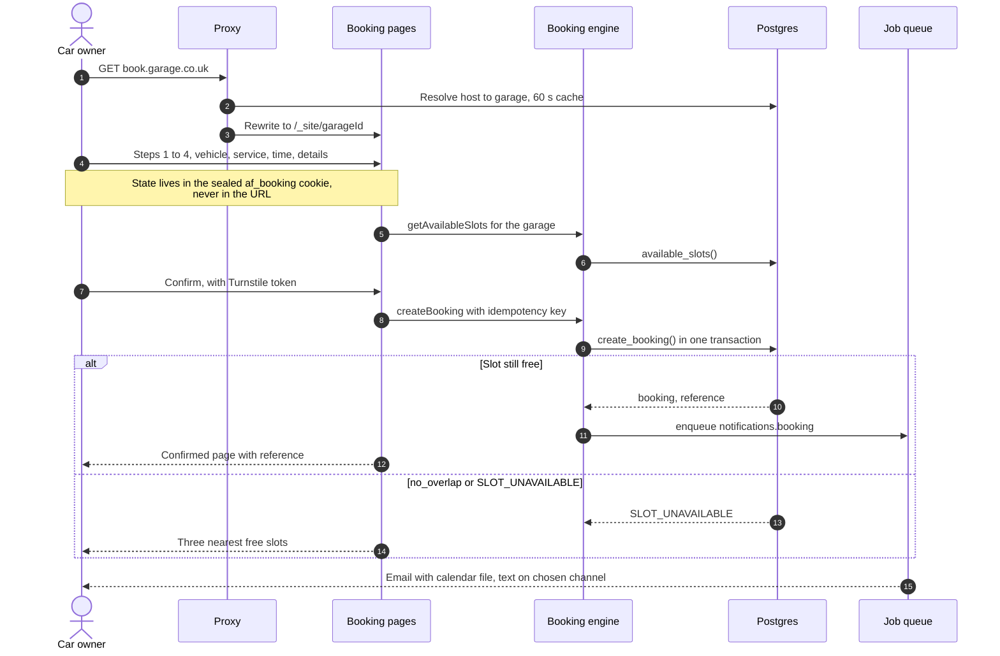
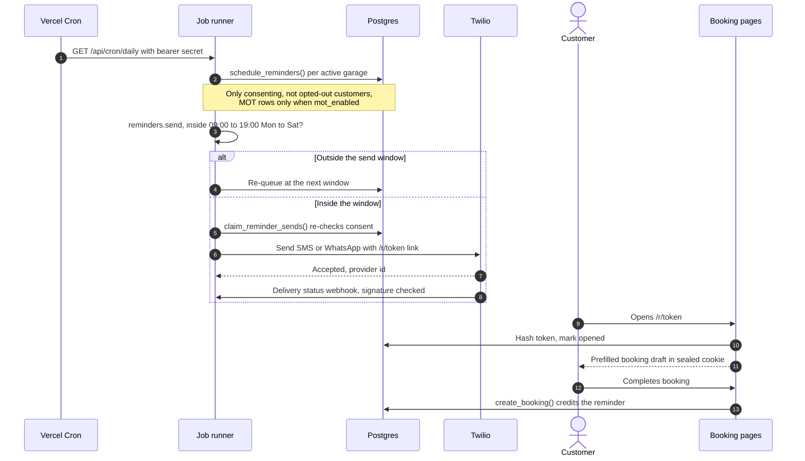
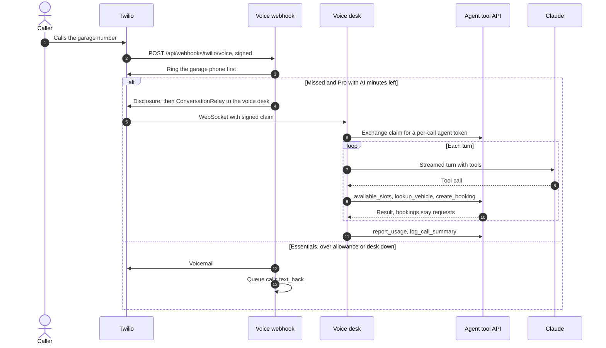
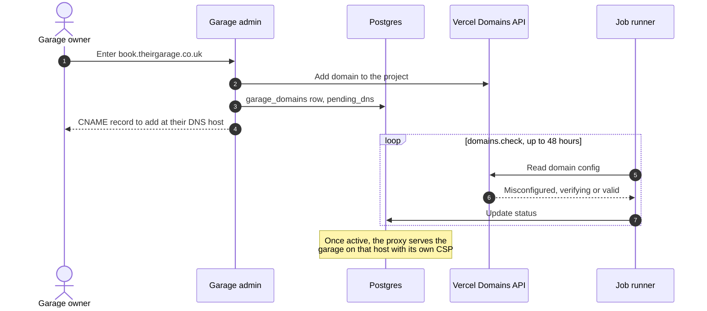
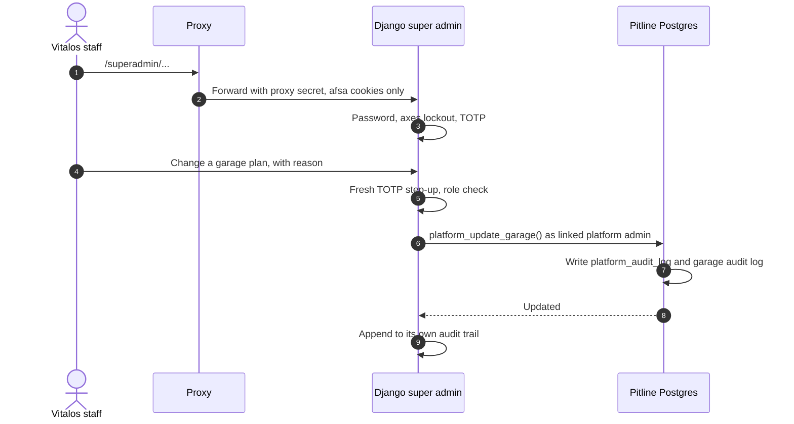
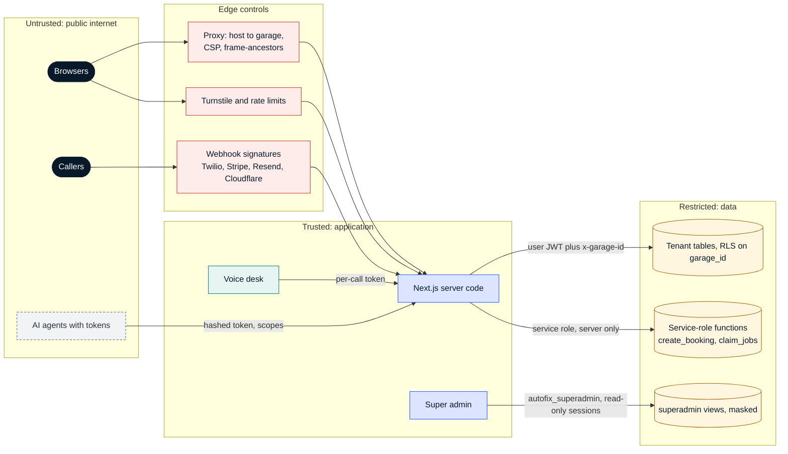

# Key flows and security

Snapshot `82578f9`, 3 Nov 2026. Back to [README](README.md).

## Key flows

### 1. Online booking on a garage host

The host decides the garage before anything renders. Booking state between steps is a sealed, httpOnly cookie, so a registration never appears in a URL, analytics event or ordinary log.

### 2. MOT or service reminder that wins a booking back

Scheduling and consent checks live in SQL; the send respects quiet hours (09:00 to 19:00, Monday to Saturday, in the garage's time zone). A booking made from the reminder link is credited to that reminder in the same transaction.

### 3. Missed call answered by the AI voice desk (Pro)

Twilio rings the garage first. A missed call on a Pro garage with AI minutes left hears the disclosure and is connected to the voice desk, which can only use the agent tool API with a token scoped to that one call. Bookings it makes are always requests for staff to accept. Anything else falls back to voicemail and a text-back.

### 4. Connecting a garage's own booking domain

### 5. A Vitalos staff change in the super admin

## Security

### Trust boundaries

### Authentication

| Who | How |
| --- | --- |
| Car owners | No account. A booking is managed through an HMAC-signed link (stored hashed) or reference plus registration posted in a form, which opens a 30-minute signed session cookie |
| Garage staff | Supabase Auth email sign-in; TOTP is mandatory for owners by default, with recovery codes and trusted devices |
| Vitalos platform admins (Next.js `/admin`) | Listed in `platform_admins` and signed in at AAL2 (TOTP) for every platform function |
| Vitalos staff (Django super admin) | Own accounts with django-axes lockout and TOTP for every role, plus a fresh code for each change, personal-data view, voicemail playback or support session |
| AI agents | `Bearer afat_…` agent tokens, stored as an HMAC with a server-side pepper, scoped to named tools; `workforce` tokens need Pro, `askbridge` tokens may hold only read-only tools |
| Voice desk | Signed, 5-minute claim from the voice webhook, exchanged for a per-call agent token |
| Webhooks | Twilio signature on the raw request, Stripe and Resend signing secrets, HMAC-signed inbound email from Cloudflare; cron and drain calls need a bearer secret checked in constant time |

### Authorisation

- Row-level security on every tenant table; the garage comes from the host or the member's selected garage, never from the request body (a `garageId`, `source` or `reminderSendId` in a public body is rejected with 422).
- Roles per garage: owner, manager, technician (plus front desk for staff bookings). Owner-only actions are enforced in policies and in security-definer functions.
- Booking, scheduling, reminder and job functions are executable by the service role only and filter every statement by garage.
- Support sessions ("View as support") are read-only transactions, last at most two hours and are written to both audit logs.
- The super admin's database role reads masked views and can call four functions; the app refuses to migrate or write the Pitline database alias.

### Secrets

Server secrets live in Vercel environment variables (marked Sensitive), GitHub Actions secrets and variables, and Google Secret Manager for the Cloud Run services. Nothing secret uses a `NEXT_PUBLIC_` name. The deploy workflows sign in to Google Cloud with Workload Identity Federation instead of stored keys, and only add versions to secrets that already exist. Variable names are listed in `.env.example`, `superadmin/.env.example` and `docs/autofix/INFRA.md`.

### Data protection and privacy

- UK data residency: database, functions and containers all run in London.
- Registrations are kept out of URLs, analytics and ordinary logs; `vehicle_facts` stores only a peppered hash of the registration.
- Reminders and campaigns need stored consent with the exact wording agreed to; STOP is honoured at once and also cancels scheduled reminders; offers consent is separate from reminder consent.
- Retention: message bodies, reminder bodies and voicemail links are cleared after 12 months; vehicle facts after 30 days; finished jobs after 14 days.
- The super admin sees masked phones, emails and registrations; opening a customer's details or playing a voicemail is audited.
- Garages accept the DPA in the admin; the acceptance and the text hash are stored.

### Abuse controls

Turnstile and per-IP and per-garage rate limits on public booking and contact routes; idempotency keys on bookings; strict JSON bodies with size limits on webhooks and APIs; per-host CSP with `frame-ancestors` limited to the garage's own sites; `Referrer-Policy: no-referrer` on token links.

### Main risks

| Risk | Where it stands |
| --- | --- |
| Supabase Free plan has no point-in-time recovery and pauses when idle | Pro plus PITR to be decided before the first paying garage |
| Vercel Hobby allows one daily cron and is non-commercial | Reminders go out once a day; Vercel Pro decision is pending |
| Self-hosted CI runners depend on a single machine | AWS fallback runner scripts exist (`infrastructure/runner/`) |
| Scale-to-zero voice desk can drop the first call of a cold start to voicemail | Keeping one instance warm is an open cost decision |
| Twilio trial account limits who can call or receive texts | Upgrade and UK mobile number need owner approval |
| Two super admins (Next.js `/admin` and Django) | Both write the same platform audit log; retiring `/admin` is an open decision |
